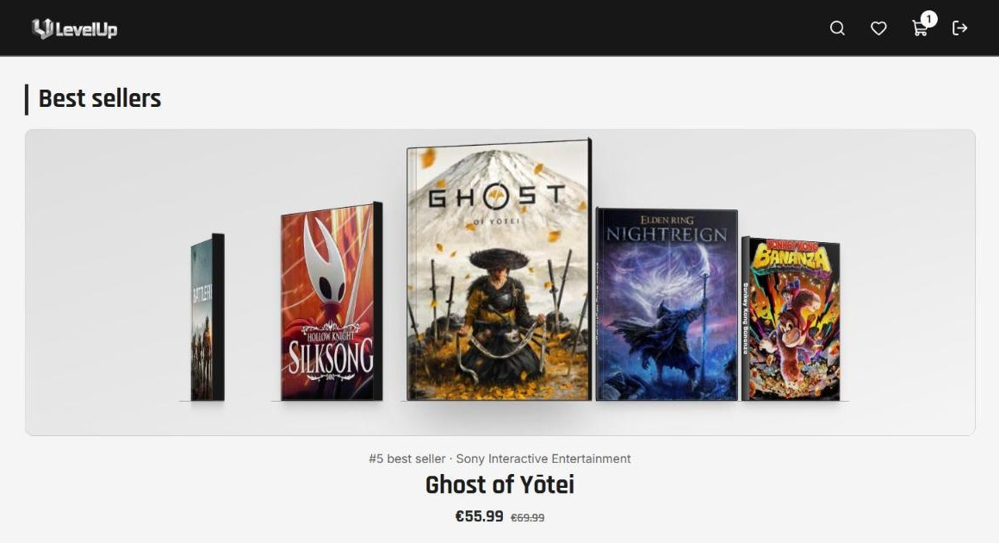
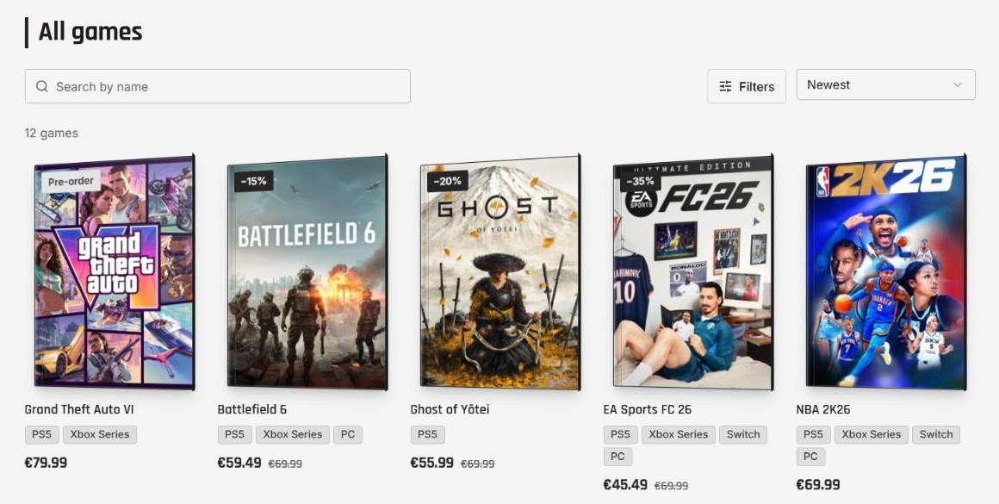
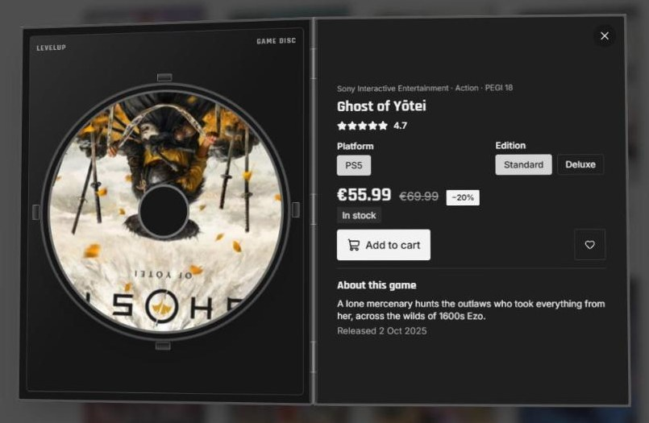

# LevelUp

An online shop for new video games, built mobile first. Browse the catalog, search and filter by
platform, genre, price and age rating, open a game, pick the platform and edition, and add it to
the cart. Admins can add and edit games.

Frontend for AI-DEV 2026 · Workshop 3, built with Claude Code from the
[ai-frontend-starter](https://github.com/jovanp-najveci/ai-frontend-starter). Data is mocked for now;
the backend comes next workshop.

## Screenshots

**Best sellers.** A 3D ring of game boxes that rotates on its own; the main game steps out toward the viewer.



**Catalog.** Every game as a 3D box, with search, filters, sorting, platforms and discounts.



**Opening a game.** The box flies to the center and opens like a DVD case; the disc spins and the right side holds platform, edition, price and add to cart.



## Run it

Requires Node 22 and [pnpm](https://pnpm.io).

```bash
pnpm install
pnpm dev              # http://localhost:5173
```

Demo accounts (mock sign in, any password of 6+ characters):

| Email | Role |
| --- | --- |
| `ana.radovic@gmail.com` | customer |
| `marko@levelup.me` | admin (can add and edit games) |

Other commands, all from the repo root: `pnpm typecheck`, `pnpm lint`, `pnpm build`, `pnpm format`.

## Screens

| Route | Screen |
| --- | --- |
| `/` | Home: New, Best sellers and On sale carousels |
| `/games` | Catalog: search with suggestions, filters, sort, filter chips (all kept in the URL) |
| `/games/:id` | Game: platform and edition picker, price, add to cart |
| `/cart` | Cart: quantity, remove, total (signed in only) |
| `/sign-in` | Sign in |
| `/admin/games/new`, `/admin/games/:id/edit` | Game form (admin only) |

## Project docs

| File | What it holds |
| --- | --- |
| [SPEC.md](SPEC.md) | Screens, MVP and "done when" for each screen |
| [frontend/DESIGN.md](frontend/DESIGN.md) | Colors, fonts, the game box, interactions |
| [docs/entities.md](docs/entities.md) | Game, CartItem, User and the API the backend should provide |
| [AGENTS.md](AGENTS.md), [CLAUDE.md](CLAUDE.md) | Rules for AI coding agents |

## Layout

```
frontend/src/
  app/            router, providers, routes/ (one file per route), require-auth
  features/       games, cart, users: each with api/, components/, types.ts
  components/     ui/ (shadcn) and layout/
  lib/            utils.ts, mock-db.ts
backend/          next workshop
docs/entities.md  contract between frontend and backend
```

Features never import each other; routes combine them. `pnpm lint` checks this.
